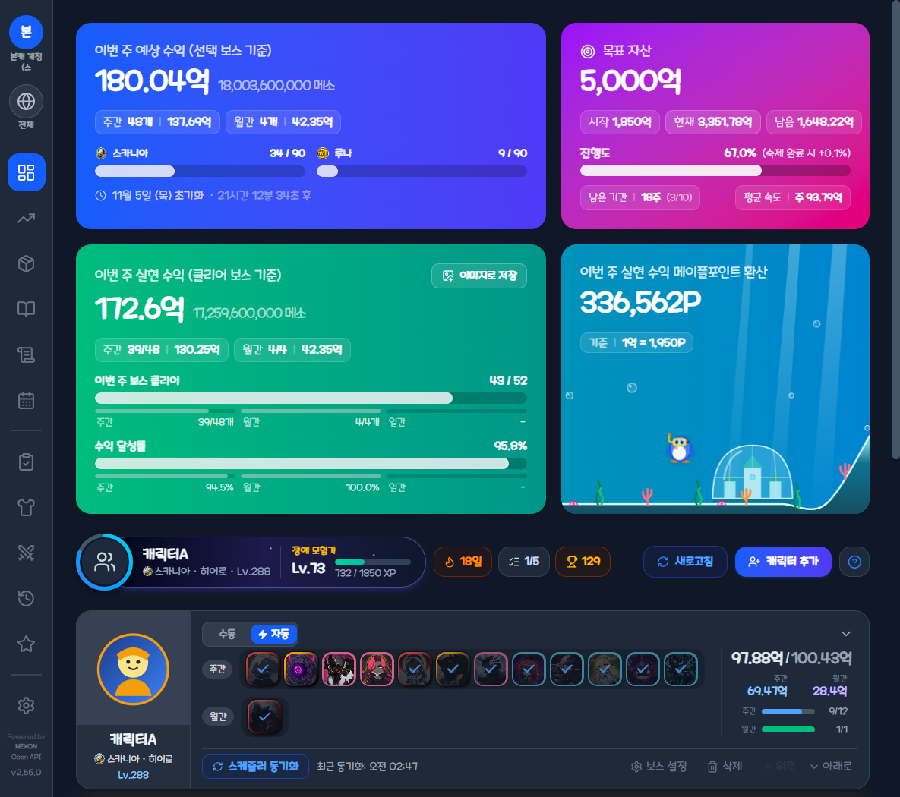

#  Maple Income Releases

메이플스토리 수익 정산 & 캐릭터·숙제·강화 통합 관리 데스크톱 앱 **Maple Income** 배포 저장소입니다.

> 👉 **12개 페이지 전체 화면 및 세부 사용법 안내**: **[https://th0079.github.io/maplestory-income-releases/](https://th0079.github.io/maplestory-income-releases/)**  
> 👉 **최신 설치 파일(`.exe`) 다운로드**: **[Releases 최신 버전 바로가기](https://github.com/th0079/maplestory-income-releases/releases/latest)**

---

## 📋 12개 사이드 페이지 요약

각 메뉴 이름을 클릭하면 **GitHub Pages 상세 가이드(해당 페이지 화면 및 세부 기능 사진)**로 이동합니다.

| 번호 | 사이드 메뉴 | 핵심 기능 |
| :---: | :--- | :--- |
| **01** | **[대시보드](https://th0079.github.io/maplestory-income-releases/#page-01)** | 주간·월간 보스 수익 정산, 월드 90개 한도 최적화, 등록 캐릭터 목록, 260Lv+ 빠른 등록, 보스 프리셋 |
| **02** | **[수익 현황](https://th0079.github.io/maplestory-income-releases/#page-02)** | 주간·월간 수익 추이 차트, 결정·드롭·가계부 순수익 상세 펼침, 주간/월간 결산 이미지 저장 |
| **03** | **[드롭 아이템](https://th0079.github.io/maplestory-income-releases/#page-03)** | 드롭 수익 내역, 미판매 드롭 보관함, 파티 분배금 계산기, 빠른 시세 등록 및 변동 그래프 |
| **04** | **[가계부](https://th0079.github.io/maplestory-income-releases/#page-04)** | 월간 수입·지출 요약, 카테고리 비중 차트, API 강화 비용 원클릭 불러오기 |
| **05** | **[사냥 기록](https://th0079.github.io/maplestory-income-releases/#page-05)** | 항상 위 사냥 위젯(타이머·버프 알림), 소재비(30분 단위)·전후 차이 계산, 조각 환산 수익 통계 |
| **06** | **[활동 달력](https://th0079.github.io/maplestory-income-releases/#page-06)** | 보스·드롭·가계부 일별 수익 달력 및 날짜별 상세 내역 팝업 |
| **07** | **[스케줄러 컨텐츠](https://th0079.github.io/maplestory-income-releases/#page-07)** | 에픽 던전, 몬스터파크, 길드 수로/플래그, 심볼 일일 퀘스트 API 동기화 |
| **08** | **[장비 확인](https://th0079.github.io/maplestory-income-releases/#page-08)** | 장착 장비 24슬롯 그리드 및 스타포스·추옵·잠재·에디셔널 상세 툴팁 |
| **09** | **[캐릭터 스펙](https://th0079.github.io/maplestory-income-releases/#page-09)** | 스탯·전투력, V매트릭스, 6차 HEXA, 심볼, 유니온, 어빌리티, 세트 효과 펼침, 링크 스킬 |
| **10** | **[캐릭터 히스토리](https://th0079.github.io/maplestory-income-releases/#page-10)** | 기간별(7일/30일/1년/전체) 경험치·레벨·전투력·유니온·아티팩트 레벨 성장 차트 |
| **11** | **[강화 기록](https://th0079.github.io/maplestory-income-releases/#page-11)** | 스타포스·잠재능력·큐브 사용 내역 조회, 장비별 소비 메소 및 기댓값 대비 편차 분석 |
| **12** | **[설정](https://th0079.github.io/maplestory-income-releases/#page-12)** | 통합 프로필, 5개 다계정·API 키, 출석·펫·마을, 퀘스트, 업적·도감, 목표 자산·테마·정보 |

---

## 🚀 시작 방법 (4단계)

1. **설치 및 실행**: [Releases](https://github.com/th0079/maplestory-income-releases/releases/latest)에서 최신 `Maple-Income-Setup-x.y.z.exe` 다운로드 및 실행
2. **NEXON Open API 키 등록**: **[설정 → 계정]**에서 API 키 입력 시 캐릭터 목록·스케줄러·강화 이력 연동 활성화
3. **캐릭터 & 보스 등록**: **[대시보드 → + 캐릭터 추가]**로 260Lv+ 캐릭터 등록 후 자동 모드 또는 18단계 프리셋 적용
4. **수익 정산 & 기록 관리**: 매주 목요일 00:00(KST) 자동 정산 및 12개 메뉴에서 수익·숙제·장비·스펙·강화 확인

---

## 🔒 NEXON Open API 이용 및 데이터 보안 안내

- **API 키 OS 암호화 저장**: 등록한 NEXON Open API 키는 Electron `safeStorage`를 통해 사용자 PC 내부에만 암호화되어 저장되며 외부 서버로 전송되지 않습니다.
- **로컬 SQLite 보관**: 모든 캐릭터·보스·가계부·사냥·강화 캐시 데이터는 PC 로컬 SQLite DB에 저장되며, JSON 백업 파일로 내보내거나 복원할 수 있습니다.
- **Data based on NEXON Open API**: 본 프로그램은 NEXON Open API를 활용하여 제작된 개인 개발 애플리케이션입니다.
